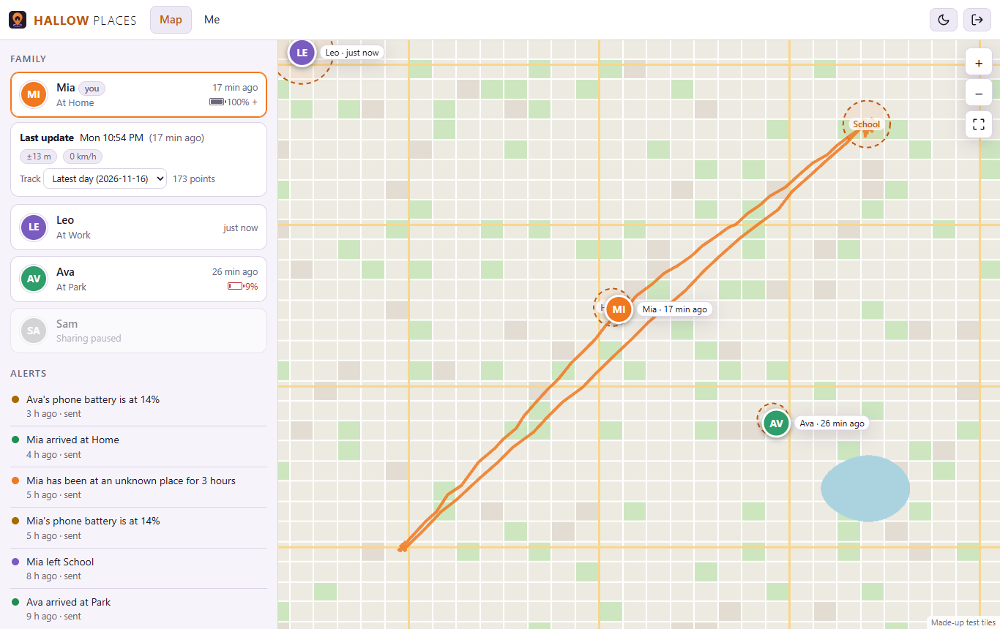
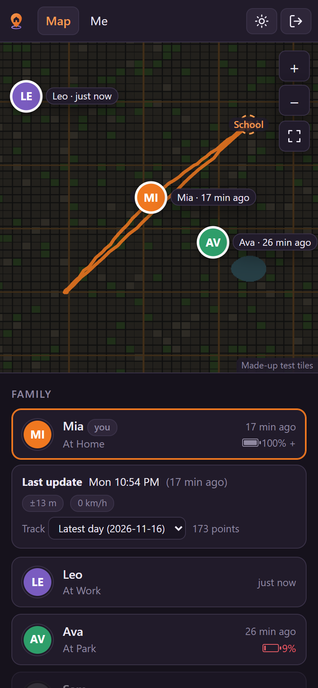
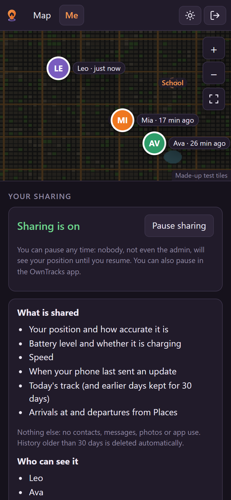

# Hallow Places

**Private family location sharing on your own server - like Life360, but self-hosted, with smarter alerts.**

Part of the Hallow family. The phones run the free, open-source **[OwnTracks](https://owntracks.org)** app (iOS and
Android); Hallow Places is the server, the map and the alerts. It runs in Docker on your NAS behind a Cloudflare Tunnel
(see [NAS-DEPLOY.md](NAS-DEPLOY.md)) and needs no npm packages - just Node's standard library.

## For families who know and agree - never covert

Hallow Places is for people who **know they are sharing and agreed to it**: parents and teenagers who talked it over,
partners, grandparents who want help. It is not for tracking anyone secretly, and it is built so it can't be used that
way quietly:

- Sharing needs the OwnTracks app installed **on the person's phone**, set up with their own QR code, and the app shows
  that it is running. Nothing is hidden.
- Everyone with a sign-in has a **Me** page that says **exactly what is shared and with whom**: which details (position,
  accuracy, battery, speed, last update, the day's track, arrivals and departures), every name that can see them, the
  admin, where alerts about them go (Discord / ntfy), and how long history is kept.
- **Pause sharing** is one button. While paused, **nobody sees the person - not even the admin** - and nothing their
  phone sends is kept. **Only the person can resume.** (They can also pause in the OwnTracks app.)
- **Delete my history** removes every saved position and every alert about them, at once. History older than the
  retention (30 days by default) is deleted automatically.

Tracking someone without their knowledge is wrong and in many places illegal. Don't use Hallow Places for it.

## What it does

- **The map** (any browser, phone-friendly, light and dark): everyone's last position with an accuracy circle, battery,
  speed and "last seen"; tap a person for their **track** of the day (or an earlier day within the retention); **Places**
  drawn as circles. The map renderer is written for Hallow Places (pan, pinch, wheel, double-click zoom); tiles come from
  OpenStreetMap by default, or any tile server you set.
- **Smarter alerts** - the main reason to use it over Life360:
  - **Arrive / leave with hysteresis.** Fixes worse than 100 m are ignored; "arrived" needs 2 fixes inside or one fix
    whose accuracy is well inside; "left" needs fixes outside a larger **exit radius** (1.5 x the radius, at least
    +50 m) for 3 minutes - or one fix clearly far away. A phone resting at the edge of home with GPS jitter never sends
    "left home / arrived home / left home". OwnTracks' own region events are used too, but **cross-checked** against
    the fix they come with.
  - **Rules**: "*hasn't left Home by 07:30*" and "*hasn't arrived at School by 08:45*" (on chosen weekdays), **battery
    under X%**, **no update for N hours**, **stays at an unknown place for N hours**, and arrive / leave for chosen
    people and Places.
  - **No spam**: each alert once (battery again only after charging or 5 points up; no-update again only after a new
    update), and the same arrive / leave not again within the cool-down (15 minutes).
  - **Quiet hours per person**: alerts about them still show in the app, but aren't pushed.
  - **Delivery**: the in-app **Alerts** list, a **Discord webhook** and/or **ntfy** (ntfy.sh or your own). The webhook
    URL and ntfy token are write-only on the Admin page and never logged.
- **Phone setup by QR code**: the Admin page (or the person's own Me page) shows a QR code with the OwnTracks
  configuration, plus *Open in OwnTracks* and a one-time `.otrc` download. Places are sent to the phones as OwnTracks
  regions, and the family shows up in the OwnTracks app's own map too (optional).
- **Admin page**: people (sign-in, initials, colour, quiet hours, phones and tokens), Places (click the map), rules,
  alert channels, history retention, map tiles, time zone and the arrive / leave tuning.

| | |
|---|---|
|  |  |

## Security and privacy

- **OwnTracks HTTP mode** with HTTP Basic: each phone has its own **long random token** (256 bits); the server keeps only
  its SHA-256, so it can't be read back. A new phone setup signs out the old phone. Failed phone sign-ins are limited per
  visitor.
- **Payload encryption** (on by default): the phone seals every message with OwnTracks' `encryptionKey` (libsodium
  **secretbox**, XSalsa20-Poly1305) on top of HTTPS. Node has no Salsa20, so Hallow Places has a small pure-JavaScript
  secretbox (`server/lib/secretbox.js`), tested against the NaCl reference vector, the RFC 8439 Poly1305 vector and
  Node's own ChaCha20-Poly1305. When encryption is on, unencrypted messages from that phone are dropped and the Admin
  page says so. Replies to the phone are sealed too.
- **Web sign-in**: per-person passwords and the admin password are **scrypt** hashes; sessions are random, HttpOnly,
  SameSite=Strict cookies; changing a password signs out other sessions; failed sign-ins are limited per visitor.
  The first admin password needs a one-time code from the server log.
- Strict Content-Security-Policy (no inline scripts), no framing, every POST needs a custom header (no cross-site forms).
- **Nothing leaves your server** except your alert pushes and the browsers' map-tile requests. Locations, tokens,
  passwords and the webhook are never written to the log.
- **Storage**: one append-only JSONL file per person per day in the Docker volume, deleted after the retention you
  choose; "delete my history" per person.
- Limits worth knowing: the admin runs the server and could read its files; the pause and consent features protect
  people from the app, not from someone with root on your NAS. Viewers see everyone who shares (no per-viewer
  circles in 1.0).

## Hallow apps on the PC

- **Hallow Browser**: add the map as a **sidebar panel** - the **+** at the bottom of the sidebar rail (or Settings > Sidebar), then
  `https://places.hallowservices.com` (your address). It signs in like any site and stays signed in (up to 30 days
  without use; restarting the server signs everyone out).
- **Hallow Remote** can link to the map later (see the roadmap). There is no PC app to install: Hallow Places is a
  server plus a web page.

## Running it

See **[NAS-DEPLOY.md](NAS-DEPLOY.md)**: `docker compose up -d --build` on the NAS, a Cloudflare Tunnel route for
`places.<your domain>`, then set the admin password with the one-time code from `docker logs hallow-places`.

To try it on a PC: `cd server`, `ADMIN_PASSWORD=choose-a-password node server.js`, open `http://localhost:8080`.

Tests: `cd server && npm test` (unit tests: OwnTracks parsing, geofences and hysteresis with synthetic and replayed GPS
traces, every alert rule, quiet hours, de-duplication, auth, retention and deletion, secretbox vectors, the QR encoder
read back by an independent decoder, the HTTP API). `node test/integration.mjs` runs the server with a fake OwnTracks
phone replaying a made-up day, local stand-ins for Discord, ntfy and the map tiles, and headless Edge screenshots at
phone and desktop sizes in light and dark. All places and positions in the tests and pictures are made up (in the open
Atlantic Ocean).

## What's new

- **1.0.1** - Percentages read 45% instead of 45 %.
- **1.0** - First release: the OwnTracks HTTP endpoint (location, transition; other types accepted and ignored) with
  per-phone tokens and payload encryption (pure-JS secretbox); the map web app with its own tile renderer, tracks,
  Places, light / dark and a phone layout; arrive / leave with hysteresis and cross-checked phone region events; rules
  (hasn't left / hasn't arrived by, battery, no update, stationary at an unknown place); quiet hours and de-duplication;
  Discord webhook, ntfy and the in-app feed; phone setup QR codes and one-time `.otrc` links; the Me page with what's
  shared and with whom, pause / resume and delete my history; the Admin page; JSONL history with retention; Docker,
  NAS-DEPLOY.md and deploy-nas.mjs.

## Credits

OwnTracks is a separate open-source project (owntracks.org). Map data in the default tiles: (c) OpenStreetMap
contributors.
